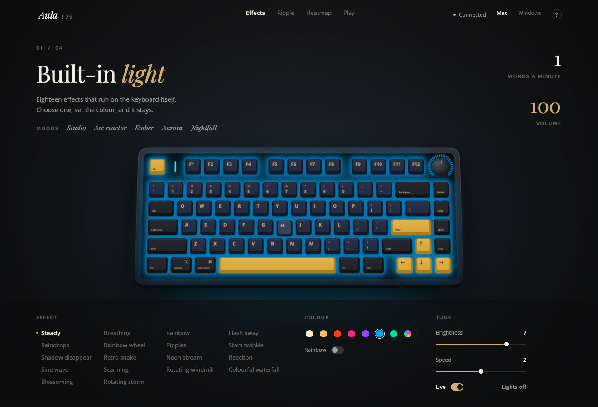
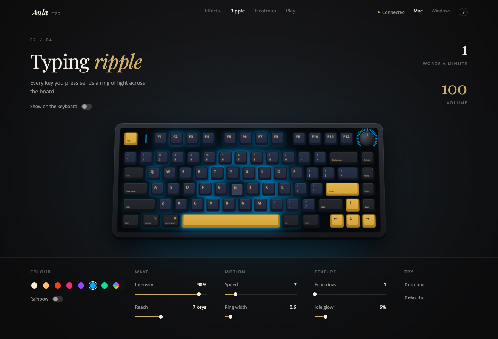
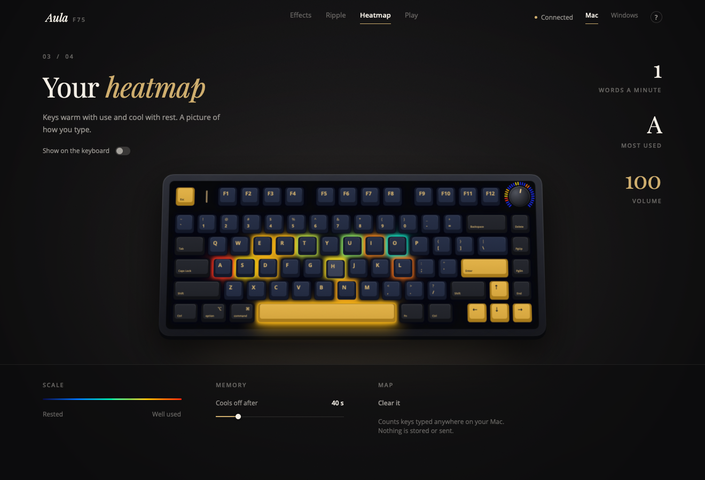
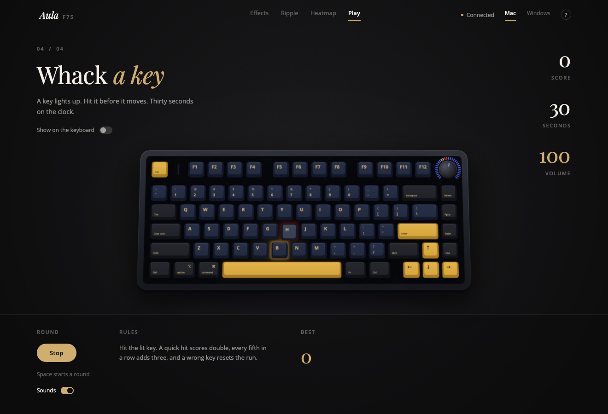

# Aula Lights

A small, native Mac app for the **AULA F75** keyboard. Control its lighting, make it react to your typing, and give it a proper Mac layout. AULA only ships a Windows driver; this fills the gap.



## What it does

- **Built-in effects.** All 18 of the keyboard's own lighting effects, with colour, brightness and speed. Changes are saved on the keyboard, so they stay after you unplug.
- **Typing ripple.** Every key you press sends a ring of light across the board. Tune intensity, reach, speed, ring width and echo rings.
- **Heatmap.** Keys warm up the more you use them and cool down when you don't.
- **Whack-a-key.** A 30-second game: a key lights up, you hit it. Combos, a countdown and a best score.
- **The knob as a dial.** Optional. Click the knob to open a ring on screen: Apps (your Dock), Volume, Keyboard lights, Screen brightness, Tracks and Play/Pause. Pointing at Tracks or Play/Pause shows what's playing in any app (Arc, Spotify, Music…); turning with Tracks skips one song per turn. Turn to choose, click to pick; turning while the ring is closed does the chosen tool. Double-click mutes. Whenever the app isn't running, the knob is plain volume again.
- **Mac layout.** One switch swaps Alt and Win so they act as Command and Option, like a Mac keyboard. It only affects the AULA, and it re-applies itself after every reconnect.
- **Moods.** One-click looks (Studio, Arc reactor, Ember, Aurora, Nightfall). Hover any effect or mood to preview it on screen first.
- **Themes.** Dark or Light (or Auto, following your Mac), six accent colours, and a switch for the ambient touches. The drawn keyboard always keeps its real colours.
- **Keyboard shortcuts.** Cmd-1 to Cmd-4 switch modes, arrow keys change the effect and brightness, `?` shows them all.
- **A live picture of your keyboard.** The on-screen F75 mirrors the real lighting, shows keys going down as you type, and the knob turns with the real one, with a ring showing your volume.

| Typing ripple | Heatmap | Whack-a-key |
| --- | --- | --- |
|  |  |  |

## Requirements

- macOS 14 or later
- An AULA F75, connected with the **USB-C cable** or the **2.4 GHz receiver**. Everything works over both. Over the receiver the live modes (ripple, heatmap and game on the keyboard itself) update 20 times a second in small pieces, with a slightly simpler set of colours, to stay inside the radio's limit. Over Bluetooth the keyboard only shares part of its settings, so the app can't change the lighting safely there; it still works as a keyboard, and the live modes show on screen.

## Install

**Download:** grab `Aula-Lights-1.0.dmg` from the [latest release](https://github.com/rushi007941/aula-lights/releases/latest), open it, and drag **Aula Lights** onto Applications. It runs on Apple-silicon and Intel Macs.

The first time you open it, macOS says it can't check the app, because it isn't from the App Store and isn't notarized. Click Done, then go to **System Settings → Privacy & Security**, scroll down, and click **Open Anyway** next to Aula Lights. You only do this once.

A short welcome screen then walks you through the two setup steps. macOS asks to allow it under **System Settings → Privacy & Security → Input Monitoring**. That permission is needed because the keyboard's lighting controls sit on the same USB interface as its keys, and so the app can see key presses for the ripple, heatmap and game. Key presses are only used to draw the lights; nothing is stored or sent anywhere.

**Mac layout and the dial** use a small background helper. The app installs it the first time you switch either on. To remove it later: `launchctl bootout gui/$(id -u)/com.aulalights.remap`, then delete `~/Library/LaunchAgents/com.aulalights.remap.plist` and `~/Library/Application Support/aula-remap`.

**Build it yourself** (needs the Xcode Command Line Tools, `xcode-select --install`):

```bash
git clone https://github.com/rushi007941/aula-lights.git
cd aula-lights
./build.sh      # builds for this Mac and installs to ~/Applications
./package.sh    # makes dist/Aula-Lights-<version>.dmg, universal (Apple silicon + Intel)
```

There's also a command line, handy for scripts:

```bash
./aula-lights status
./aula-lights set --effect breathing --color 00AAFF --brightness 9
./aula-lights off
./aula-lights restore   # put back the lighting from before a live mode, if the app ever quit mid-stream
```


## How it stays safe

This is an unofficial tool, so it is deliberately careful with your keyboard:

- **It never rebuilds the keyboard's settings.** It reads them, changes only the lighting bytes, checks the block is complete (the `5A A5` signature) and writes it back. Rebuilding the settings from scratch is known to break the Fn layer.
- **Every change is read back.** If anything doesn't match, the previous lighting is restored.
- **Live modes are paced** at 20 frames a second over the cable (the keyboard drops keypresses faster than about every 46 ms), and over the receiver at 20 small updates a second, sending only the keys that changed, never more than 60 parts a second (the board starts to flicker above 64).
- **Your lighting comes back.** Before a live mode starts, the current lighting is saved to disk and restored when you turn it off, quit, or even after a crash.
- It doesn't touch firmware, and the Windows driver isn't needed.

## Credits

The lighting protocol comes from people who reverse-engineered it before me:

- [headblade-dev/keylux-linux](https://github.com/headblade-dev/keylux-linux), the most careful protocol notes (streaming, timing, safety)
- [daschinmoy21/aula-f75-linux](https://github.com/daschinmoy21/aula-f75-linux)
- [mohithingorani/aula-macos-software](https://github.com/mohithingorani/aula-macos-software)

Type: [Playfair Display](https://github.com/googlefonts/Playfair) and [Open Sans](https://github.com/googlefonts/opensans), both under the SIL Open Font License (included in `Fonts/`).

## Licence

MIT; see [LICENSE](LICENSE). The bundled fonts are under the SIL Open Font License.

## Disclaimer

Not affiliated with or endorsed by AULA. Use at your own risk. It has been tested on one AULA F75 over USB-C on macOS 26.
