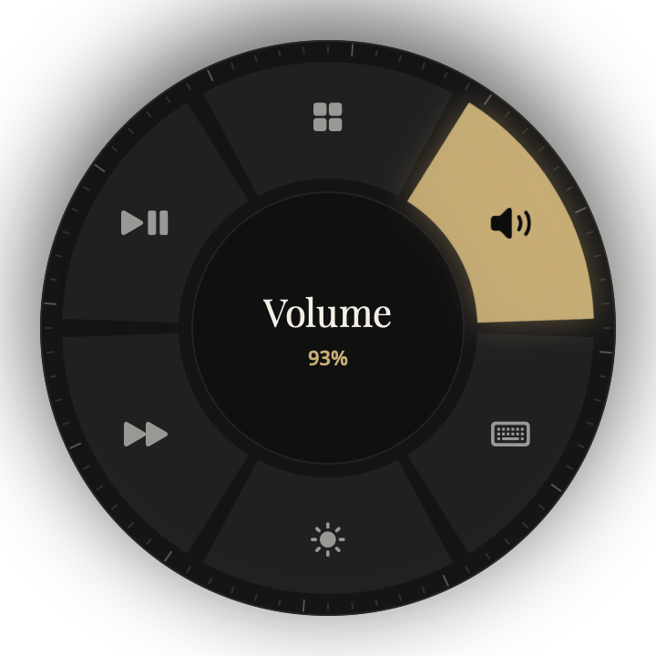
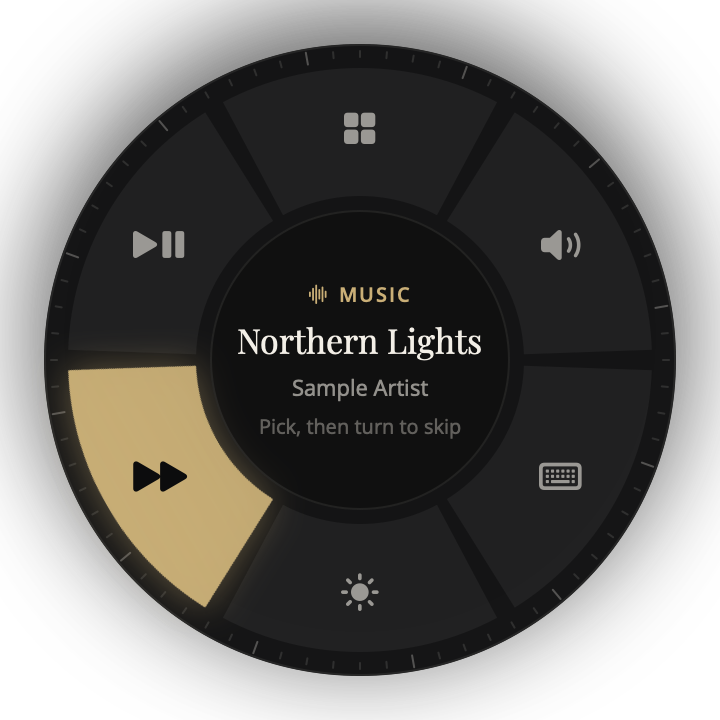
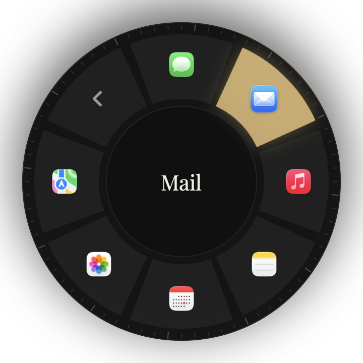
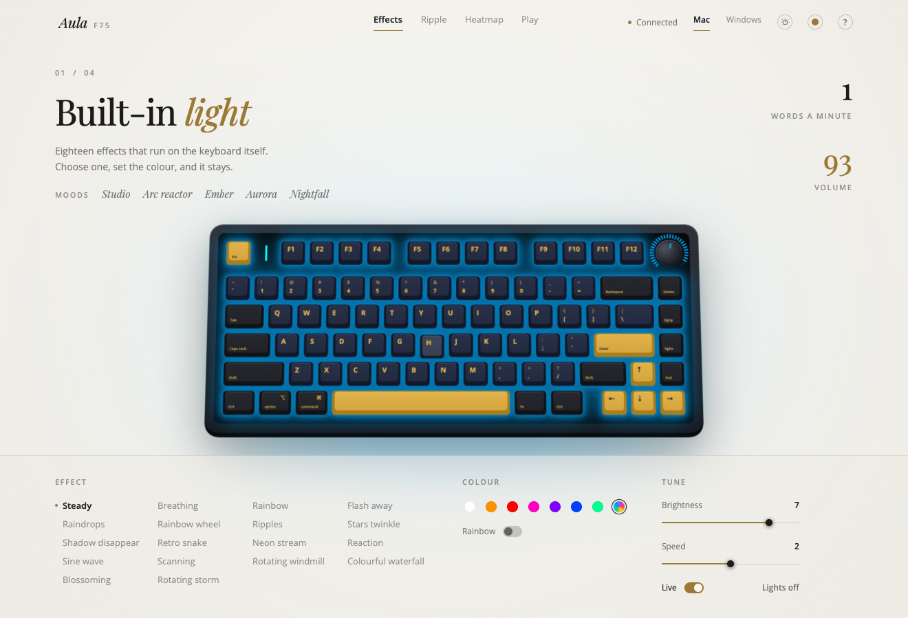

# Aula Lights

**Make your AULA F75 work like a real Mac keyboard.** Free.

The AULA F75 is made for Windows, so on a Mac the keys at the bottom left are in the wrong place: **Alt** is where **⌘ Command** should be, and **Win** is where **⌥ Option** should be. Aula Lights fixes that with one click. It also lets you change the keyboard's lights and use the round knob in new ways.


## What you get

- **A Mac layout.** One click and Alt works as ⌘ Command and Win works as ⌥ Option. Only the AULA changes; your laptop's own keyboard stays the same. Click again to go back to Windows any time.
- **Light effects.** All 18 of the keyboard's light shows, in any colour, brightness and speed.
- **Fun extras.** Light that ripples out from every key you press, a "heatmap" of the keys you use most, and a little reaction game.
- **The knob as a dial.** Click the knob to open a ring on screen: open apps, change the volume, skip songs, and more.

## The knob as a dial

Turn the round knob into a dial for your whole Mac. **Click the knob** and a ring appears on screen. **Turn** to move around it and **click** to choose.

| Tools | Music | Apps |
| --- | --- | --- |
|  |  |  |
| Volume, keyboard lights, screen brightness, play/pause and skipping songs. Turning the knob with the ring closed controls the one you picked. | Shows the song playing in any app (Spotify, Music, YouTube in your browser…). Turn once to skip one song. | Open any app from your Dock without leaving the keyboard. |

Double-click the knob to mute. When Aula Lights isn't running, the knob is the normal volume knob again.

## Light and dark

Aula Lights comes in **dark** and **light**, or **Auto** to follow your Mac, with six accent colours to choose from.

| Dark | Light |
| --- | --- |
|  |  |

## How to install

1. **Download** the `.dmg` file from the [latest release](https://github.com/rushi007941/aula-lights/releases/latest).
2. **Open the downloaded file** and drag **Aula Lights** onto the **Applications** folder.
3. **Open Aula Lights** from your Applications folder. Your Mac will say it can't check the app (it isn't from the App Store). Click **Done**.
4. Open **System Settings → Privacy & Security**, scroll down, and click **Open Anyway** next to Aula Lights. You only do this once.
5. The app shows three quick steps:
   - **Connect the keyboard** with its USB-C cable or its 2.4 GHz wireless receiver.
   - **Allow keyboard access** when your Mac asks (click **Open Input Monitoring**, switch on **AulaLights**, then **Reopen Aula Lights**).
   - **Make it a Mac keyboard**: choose **Mac**.

That's it. The Mac layout keeps working after restarts and reconnects.

## Using it

- **Mac or Windows layout:** the **Mac / Windows** switch at the top right of the app.
- **Lights:** pick an effect, a colour and a brightness at the bottom of the app. Changes are saved on the keyboard itself.
- **The knob dial:** click the **dial button** at the top right of the app to turn it on. Then click the knob to open the ring, turn to choose, and click to pick. Double-click the knob to mute.
- **Light or dark:** click the **coloured dot** at the top right to pick Dark, Light or Auto, and an accent colour.

## Questions

**Is it free?** Yes, completely, and the code is open for anyone to read.

**Is it safe for my keyboard?** Yes. It only changes the lighting settings, checks every change, and puts your old lighting back if anything looks wrong. It never touches the keyboard's firmware.

**Why does it need "keyboard access"?** The keyboard's light controls share a connection with its keys, so your Mac asks for permission. Aula Lights only uses your key presses to draw the lights. Nothing is saved or sent anywhere.

**Does it work over Bluetooth?** The **Mac layout works on every connection**, Bluetooth included. Changing the **lights** needs the USB-C cable or the 2.4 GHz receiver, because over Bluetooth the keyboard doesn't share enough of its settings to change them safely.

**Some light effects look dark.** **Ripples** and **Reaction** only light up when you type. If a whole effect is dark, check the **Brightness** isn't at 0.

**How do I go back to normal?** Click **Windows** at the top right for the original key layout, and turn off the dial button if you turned it on. To remove the app, quit it and drag it from Applications to the Trash (Bin).

**Does it work with other AULA keyboards?** It's made for the **F75**. Other models haven't been tested.

**Which Macs?** Any Mac with macOS 14 (Sonoma) or newer, Apple silicon or Intel.

---

<details>
<summary><b>For developers: building, command line and how it works</b></summary>

### Build it yourself

Needs the Xcode Command Line Tools (`xcode-select --install`).

```bash
git clone https://github.com/rushi007941/aula-lights.git
cd aula-lights
./build.sh      # builds for this Mac and installs to ~/Applications
./package.sh    # makes dist/Aula-Lights-<version>.dmg, universal (Apple silicon + Intel)
```

### Command line

```bash
./aula-lights status
./aula-lights set --effect breathing --color 00AAFF --brightness 9
./aula-lights off
./aula-lights restore   # put back the lighting from before a live mode
```

### The background helper

The Mac layout and the dial use a small helper (`com.aulalights.remap`) that remaps the AULA's keys with `hidutil`, for the AULA only, and re-applies it whenever the keyboard reconnects. The app installs it the first time you switch either feature on. To remove it: `launchctl bootout gui/$(id -u)/com.aulalights.remap`, then delete `~/Library/LaunchAgents/com.aulalights.remap.plist` and `~/Library/Application Support/aula-remap`. Whenever the app isn't running, the helper gives the knob back to plain volume.

### How it stays safe

- It never rebuilds the keyboard's settings: it reads them, changes only the lighting bytes, checks the block is complete (the `5A A5` signature) and writes it back. Rebuilding them from scratch is known to break the Fn layer.
- Every change is read back; if anything doesn't match, the previous lighting is restored.
- Live modes are paced: 20 frames a second over the cable (faster than every ~46 ms drops keypresses), and over the receiver 20 small updates a second of only the keys that changed, never above 60 parts a second (the board flickers above 64).
- Before a live mode starts, the current lighting is saved to disk and restored when you turn it off, quit, or after a crash.
- "What's playing" in the dial uses macOS's Now Playing service through `/usr/bin/perl`, the same workaround open-source tools like mediaremote-adapter use, because macOS 15.4+ blocks it for other apps.

### Credits

The lighting protocol comes from people who reverse-engineered it first:

- [headblade-dev/keylux-linux](https://github.com/headblade-dev/keylux-linux), the most careful protocol notes (streaming, timing, safety)
- [daschinmoy21/aula-f75-linux](https://github.com/daschinmoy21/aula-f75-linux)
- [mohithingorani/aula-macos-software](https://github.com/mohithingorani/aula-macos-software)

Fonts: Playfair Display and Open Sans, under the SIL Open Font License (in `Fonts/`).

</details>

## Licence

Free and open source under the MIT licence; see [LICENSE](LICENSE).

Not made by or affiliated with AULA. Use at your own risk.
